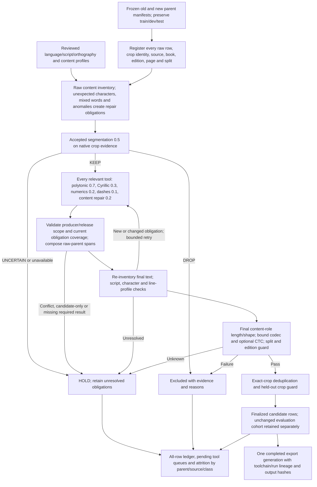

# Astra review of the integrated filtering pipeline

**Reviewer:** GPT-6 Astra (`gpt-6-astra`), extra-high reasoning. **Date:** 2026-10-18. **Scope:** filtering and correction means only, following the owner's scope clarification and subsequent acceptance of segmentation as it stands.

**Final verdict: PASS for the repaired filtering implementation.** All eight findings below are closed in the reviewed pipeline 0.2 snapshot. I independently ran **57 passing integration tests**, replayed the three additional corrective-scope counterexamples and verified the version registry's component hashes. I found no remaining engineering blocker in this review. This does **not** certify full-corpus coverage or automatic admission of rows whose evidence is still missing. [Exact reviewed files and verification receipt][review-receipt]

No training recipe, architecture, checkpoint choice or experiment-arm decision is a blocker in this review. The two future experiment families explain why old and new parent datasets both need the same filtering machinery; they do not change the filtering contract. No OCR, native-image processing, full-data census, new reader coverage or remote computation was performed for this review. Reads of source files, first-record metadata inspection and tiny synthetic metadata fixtures are the evidence used here.

| Readiness question | Verdict | Meaning |
|---|---|---|
| Does the filtering/correction implementation fit the intended sequence? | **PASS** | Ordering, all-relevant routing, composition, final checks and durable census outputs are implemented; the review defects were repaired. |
| Can the prepared runner move to worker validation and a diagnostic census? | **PASS at code level; operational HOLD** | Bind actual parent/crop/split/edition/expectation/profile inputs and verify the native adapter on the authorized worker first. Neither that smoke test nor the full census ran here. |
| Is automatic admission of the whole corpus established? | **HOLD for evidence** | Missing tool coverage, candidate releases, unavailable geometry and unresolved metadata still exclude rows. Applicable reader coverage and release audits remain to execute. |

The versions identify documented method generations: polytonic **0.7**, Cyrillic **0.3**, numerics **0.2**, dashes **0.1**, segmentation **0.5**, inventory **0.1**, and content gate/content-repair interface/composer/final eligibility/census **0.2**. Exact hashes distinguish implementation patches within those generations. Version numbers are not accuracy scores. [Version registry][versions]

## What is already sound

The implemented sequence substantially matches the intended pipeline. It registers the raw input observations before filtering, keeps unexpected characters and mixed-script words available for repair, runs segmentation before label correction, schedules multiple relevant tools, composes changes against the immutable raw parent and checks length after correction. Numeric content role is independent of the observed `nonletter` script class. It preserves excluded observations and separate evaluation diagnostics rather than silently shrinking the evaluation cohort. [Core pipeline][core] [Census runner][census]

The segmentation decision JavaScript is frozen at version 0.5. The version registry retains the five named policy checkpoints and the owner’s acceptance. The saved parity receipt reports identical decisions and reasons on all 888 existing observations and no new images processed. The Rust service evaluates frozen model coefficients; it contains no Python prediction fallback and does not fit new coefficients. This is good preservation evidence for the accepted policy, rather than a claim that the whole corpus has been measured. No additional segmentation tuning or native-positive qualification is required by this review. [Version registry][versions] [Parity receipt][parity] [Frozen policy][seg-policy] [Rust prediction][rust]

The new census runner also removes the old experiment's hardcoded selected-row universe: it accepts configured parent manifests, verifies their hashes/counts and registers each observation before the filtering loop. SQLite stores raw observations, decisions, corrections and native measurements. Code/configuration drift prevents reuse of a ledger. Missing native evidence and infrastructure errors have different dispositions; worker timeouts terminate a process group. These are meaningful implementation improvements, subject to the closure findings below. [Input registration][census-registration] [Native worker][native-worker]

## Numbered findings and closure checks

### F1 — PASS after repair: newly introduced correction obligations are held

**Evidence.** The initial rerouting loop discovered tool names from the composed label, but `automatic_result` and the external corrector received the unchanged raw row. Its `scheduled` set prevented a tool from being reconsidered after new relevant text appeared. The old regression test verified only that a numeric route existed, not that its evidence covered the new candidate. [Core routing][core] [Pipeline tests][tests]

**Reproduced failure.** A qualified edit changed `λόγος καὶ γράμματα` to `λόγος καὶ γράμματα 1.234`. The row was admitted with a numeric `verified_no_change` result saying that no separator candidate existed. The same false admission occurred when the raw label already contained `1234` and correction changed it to `1.234`; in that case the numeric tool had already been scheduled.

**Required closure.** Track each tool's relevant candidate or span obligation on the composed label. A raw-parent result remains valid only for the obligations it actually covers. New or changed relevant spans must acquire matching qualified evidence or remain held. Automatic negative scans must inspect the relevant current text; no-change claims must carry the text/candidate identity they certified. Keep raw-parent edit coordinates and bounded rerouting. Existing unrelated corrections should not trigger unnecessary reader reruns.

**Verified repair.** Version 0.2 fingerprints per-tool candidate text with raw-coordinate anchors, refreshes automatic scans on the composed label and exports explicit recheck obligations when coverage changed. Both the new-separator counterexample and an independent Greek-accent/numeric-separator composition are covered by passing regressions: the former holds and the latter remains admissible. [Candidate scope][candidate-scope] [Scope revalidation][scope-revalidation]

### F2 — PASS after repair: historic producer identity and adapter identity are separate

**Evidence.** Saved SF7 records contain a `policy_digest` beginning `f41e0563`, together with parent, job, variant and wave fields. The original adapter discarded these fields and returned the current registry's tool digest. That identifies the present adapter/toolchain, not the historical producer of the saved correction. The artifact hash made the original recoverable but did not make the normalized row's claim accurate. [Legacy adapter][adapter] [SF7 saved edits][sf7-edits] [Version builder][version-builder]

**Required closure.** Preserve producer identity and original-record hash separately from the adapter version/toolchain digest. Check any producer constraints in the release manifest against the record. Carry a compact complete toolchain/run-binding fingerprint on decisions and exports, so detached rows remain attributable to the exact filtering run. A historic correction does not need to be rerun merely to acquire truthful lineage. SF7's candidate-pre-audit status must remain visible.

**Verified repair.** The adapter retains producer fields and original-record hash, checks declared producer constraints and identifies the adapter separately. Canonical results receive equivalent release provenance. Every ordinary decision carries toolchain versions/digest; the census attaches its complete run-binding fingerprint, also present in the generation receipt. Producer-mismatch rejection and detached-decision lineage tests pass. [Legacy adapter][adapter] [Canonical provenance][canonical-provenance] [Decision persistence][decision-persistence]

### F3 — PASS after repair: canonical correction identity is validated at import

**Evidence.** `ArtifactCorrector.load` originally indexed records by top-level `id` or `line_id`. The declared canonical result schema binds identity inside `binding.id`; the implementation's own result constructors use that shape. A normal canonical result therefore entered the corrections table under a null ID and was never returned for its row. [Correction ingestion][census-corrections] [Result validation][core]

**Reproduced failure.** Importing a complete canonical polytonic result without an additional top-level ID left the row held with “missing qualified tool result,” even though the artifact was present and fingerprinted.

**Required closure.** Resolve canonical IDs from the binding; validate parent, tool, raw text, crop, split and nonempty ID at import. Reject contradictory ID aliases, duplicate records and IDs outside the registered parent. Verify the entire artifact's transaction rolls back on an invalid record. A successful import should distinguish supplied rows from sparse omissions.

**Verified repair.** Canonical ingestion uses `binding.id`, checks tool/parent, validates the complete row binding, rejects alias disagreements and requires parent membership. It imports inside a single transaction; sparse omissions still return no result. The canonical import regression passes. [Correction ingestion][census-corrections]

### F4 — PASS after final repair: canonical status and qualified scope agree

**Evidence.** The original `SUCCESS` set permitted `tag_only` for every tool. Candidate artifacts were downgraded only when their result was `applied` or `verified_no_change`. Full canonical results bypassed substitution restrictions enforced by the legacy adapter. [Core validation][core] [Correction ingestion][census-corrections] [Legacy adapter][adapter]

**Reproduced failure.** A `candidate_pre_audit` canonical polytonic artifact with `status=tag_only` admitted its row after supplying the top-level ID needed to bypass F3. A tag could therefore stand in for a required reviewed polytonic result.

**Required closure.** Restrict successful statuses to each tool's contract; dashes are the current tag-only tool. Downgrade every qualifying status from a candidate artifact. Preserve explicit holds regardless of serialization format. Enforce the same qualified edit scope for legacy and canonical records: RU1 remains the historical Russian soft-sign/hard-sign substitution, and N1 remains its qualified separator correction. Language and orthography eligibility must be enforced independently of a result's self-declared success. Unavailable scope evidence must hold, not silently certify no change.

**First repair verified.** Candidate releases now downgrade all successful statuses; non-dash `tag_only` results are rejected. Canonical edits receive the same substitution-pair checks as legacy edits.

**Additional cases found and repaired.** In the first 0.2 snapshot, a canonical polytonic `verified_no_change` result containing `holds=["missing second reader"]` was admitted. A canonical RU1 edit changed the interior soft sign in `сильный русский текст` to `силъный русский текст` and was admitted, although the established RU1 decision function requires a word-final candidate. A Serbian declaration combined with `historical_russian` also admitted a RU1 edit because the artifact adapter checked orthography but not language. [Established RU1 decision rule][ru1-rule]

**Final independent replay.** The explicit hold now produces HOLD; the interior RU1 edit is rejected as outside qualified word-final positions; the contradictory Serbian declaration produces HOLD. The shared validator also protects legacy results before composition. Russian language and historical orthography are both required; top-level and evidence-held slots survive normalization with the original producer result retained. These are scope repairs, with no new corrective algorithm. [Hold preservation and regime eligibility][scope-guards] [Final replay receipt][review-receipt]

### F5 — PASS after repair: final content profiles are rechecked

**Evidence.** The original implementation called `profile_issues` only on the raw inventory. It reran script and character checks on final text, but did not detect a new line-profile anomaly caused by correction. [Profile checks and finalization][core]

**Reproduced failure.** A reviewed profile with `digits: [0, 0]` accepted raw Greek text. A correction added `1234`; the final inventory recorded four digits, yet the row was admitted with no profile flag and no content-repair obligation.

**Required closure.** Recheck applicable line-profile metrics on the composed label. New anomalies need independent resolution bound to the final candidate and profile identity. The raw page summary remains a description of the entire original page; do not recompute its reference distribution from filtered survivors or allow current observations to promote themselves into a trusted profile.

**Verified repair.** Rerouting now notices new profile anomalies. Finalization recomputes the anomaly list and requires a resolution fingerprint covering final text, issues and the frozen profiles. A valid final-text resolution passes; a stale one holds. Raw page summaries continue to come from all registered observations. [Final profile validation][final-profiles]

### F6 — PASS after repair: completion follows deduplication and one published generation

**Evidence.** The initial `Ledger.summary().complete` required only inventory completion, no unprocessed rows and no infrastructure errors. Deduplication and output publication happened later. A finalization interruption could therefore write `complete=true` to progress while duplicate admissions remained, or leave exports from an older retry generation. [Census summary and finalization][census]

**Reproduced failure.** Two identical admitted crop observations produced `complete=true` with two admissions before deduplication. After deduplication the same ledger had one admission and one duplicate drop. Both states claimed completion.

**Required closure.** Separate row-processing completion from finalized-output completion. Persist decision/finalization generations or equivalent durable phase markers; invalidate completion before retries mutate decisions. Deduplication and every exported file/hash must belong to the same completed generation before a release manifest declares completion. Interrupted finalization must be retryable and must not leave a usable stale release certificate.

**Verified repair.** Decision changes invalidate `CURRENT.json` before mutation. Durable row/dedup/export phases must match the generation, and `summary.complete` also requires a completed publication binding. Files are written under one immutable generation; compatibility paths resolve through a single switched directory. Dedup-crash, retry/export-crash, export-commit-crash and same-generation/hash regressions pass. Consumers must honor the documented CURRENT/summary binding rather than treat an old generation's existence as the active release. [Generation invalidation][generation-invalidation] [Generation export][generation-export]

### F7 — PASS after repair: the deadline covers the complete worker exchange

**Evidence.** `NativeWorker` used a timed `select()` followed by blocking `readline()`. The first response byte satisfied the timeout, after which a partial line could block indefinitely. Malformed JSON also escaped without closing the worker. [Native worker][native-worker]

**Reproduced failure.** A tiny fake worker wrote a partial response and slept for 0.5 seconds. With a configured timeout of 0.05 seconds, the call returned after 0.528 seconds with `JSONDecodeError`; the worker had not been reset. This used a metadata-only subprocess, not the native image pipeline.

**Required closure.** Apply a monotonic deadline across accumulation of the complete response, including partial reads. A timeout or malformed protocol response must terminate/reset the worker and reap it reliably. Add partial-output and malformed-output fixtures alongside the existing no-output timeout test.

**Verified repair.** Nonblocking request writes and response accumulation share one monotonic deadline. Exceptions close/reset the process; partial, malformed and no-output fixtures pass, including a successful fresh call after the timeout. [Worker deadline][native-worker]

### F8 — PASS after repair: frequent progress uses incremental counters

**Evidence.** Every 100 processed rows, the original loop called the detailed `Ledger.summary()`. That function deserializes every prior decision's full evidence JSON to aggregate reasons, route statuses and availability, alongside full grouped queries. The work grows quadratically in the number of rows. For 320,479 inputs, the 100-row cadence alone implies approximately 513 million cumulative decision deserializations. This is a static operation count, not a measured runtime forecast. [Census summary and processing loop][census]

**Required closure.** Use indexed counters or incremental aggregates for frequent progress updates. Generate the detailed reason/route/stratum summary once during finalization, or only when explicitly requested. The progress path should not repeatedly deserialize native evidence from completed rows. This finding does not authorize a local full-data benchmark.

**Verified repair.** Progress uses in-memory counters initialized from the ledger, updated at decision writes and emitted through `summary(detailed=False)`. A SQL trace regression verifies that frequent progress does not read observations or decisions. Full JSON aggregation is reserved for final reporting. Page summaries are cached by parent/source/book/page. This removes the identified quadratic progress scan; it is not an end-to-end speed qualification. [Progress counters][progress-counters]

## Pipeline contract being checked

This diagram describes the integrated filtering contract, including the obligations exposed by the review. It does not authorize execution or assert that new full-set coverage exists.

## Coverage and execution boundaries

Reading the first W1 and W2 snapshot records confirmed that the source adapter uses the saved `old_label` as raw text, preserves original crop paths/hashes/source-page coordinates and leaves absent split/edition declarations unresolved. This is a format check on two records, not validation of all 320,479 collection rows. The original collection parent is a separate universe; the new W1/W2 snapshots must not be relabeled as all original training data. [Source adapters][sources] [Population receipt][population]

Source/class fallback metadata deliberately does not invent Russian or Serbian historical orthography from the word “Cyrillic.” Missing corrective records remain unresolved rather than no-change. Exact crop deduplication and held-out edition/crop guards are implemented, but they require truthful, bound crop and edition metadata. Their presence does not establish that those manifests have been supplied for every parent. [Expectations and automatic results][core] [Deduplication][census]

Existing corrective evidence retains its established scope: SF7's reviewed tool and saved candidate release are distinct from the outstanding release audit and additional reader coverage; RU1's scoped substitutions do not become a general Cyrillic recognizer; the assisted N1 release does not revive the rejected automatic ink classifier; general dashes remain tags. The pipeline must report delivered, missing, held and proposal-only rows separately for every applicable tool. Exporting a pending queue is preparation for existing workflows, not completed correction. [Registry scope][versions] [Implementation handoff][readme]

After engineering closure, the next operational evidence is a bound worker smoke test and an authorized census on the named parents with actual metadata and corrective releases. Those are pending execution/evidence tasks. A diagnostic census may legitimately finish with held rows and pending queues; automatic admission of those rows remains prohibited. Neither selected challenge retention nor the 888 saved segmentation observations gives a full-set keep rate. Census outputs must supply parent/split/source/content-role/script denominators, stage exclusions, unavailable measurements, tool coverage, duplicate counts and retained unique rows before any replacement-sourcing arithmetic becomes factual.

## Verification record

The initial implementation agent reported 46 passing tests: 36 new pipeline tests plus 10 existing CP4c regressions. This reviewer independently reproduced F1, F3, F4, F5 and F6 with tiny metadata-only fixtures, F7 with a tiny fake subprocess, inspected the SF7 producer fields for F2 and counted the progress-loop work for F8. Native execution was replaced with an explicit fixture segmenter returning a bound KEEP result. No fixture result is evidence of native segmentation quality or corpus accuracy.

After the repairs, I independently ran `.venv/bin/python -m pytest -q tests/test_line_pipeline.py`: **57 passed in 1.15 seconds**. The implementation agent separately reported **67 total tests passing**, comprising these 57 plus 10 existing CP4c regressions. I reran the final three F4 counterexamples and verified every component hash listed by `verify_versions`. The exact reviewed code, tests, registry, frozen policy and parity receipt are fingerprinted in the accompanying JSON receipt. [Verification receipt][review-receipt]

The saved policy replay has **888/888 exact verdict/reason matches**, **184/184 exact source-context reconciliations**, and **888 frozen Rust predictions** with maximum absolute difference **1.4210854715202004e-13**. That receipt explicitly records zero native images processed and no refitting. The accepted segmentation policy remains unchanged. [Parity receipt][parity]

The remaining close-out work is operational: supply the bound input/metadata manifests, perform the authorized worker smoke, run the named-parent diagnostic census and complete applicable corrective evidence/audits. Keep HOLD rows in the accounting and pending queues. The full-set retention rate and replacement requirements remain unknown until those outputs exist; they are not defects that can be declared fixed by passing metadata tests.

[core]: /Users/foivoskarounos-zamparloukos/Projects/greek-ocr-toolkit-sol-recut/greekocr/harvest/line_pipeline.py
[census]: /Users/foivoskarounos-zamparloukos/Projects/greek-ocr-toolkit-sol-recut/greekocr/harvest/line_pipeline_census.py
[census-registration]: /Users/foivoskarounos-zamparloukos/Projects/greek-ocr-toolkit-sol-recut/greekocr/harvest/line_pipeline_census.py:339
[census-corrections]: /Users/foivoskarounos-zamparloukos/Projects/greek-ocr-toolkit-sol-recut/greekocr/harvest/line_pipeline_census.py:245
[adapter]: /Users/foivoskarounos-zamparloukos/Projects/greek-ocr-toolkit-sol-recut/greekocr/harvest/line_pipeline_adapters.py:24
[sources]: /Users/foivoskarounos-zamparloukos/Projects/greek-ocr-toolkit-sol-recut/greekocr/harvest/line_pipeline_sources.py:15
[native-worker]: /Users/foivoskarounos-zamparloukos/Projects/greek-ocr-toolkit-sol-recut/greekocr/harvest/line_pipeline_native.py:209
[versions]: /Users/foivoskarounos-zamparloukos/Projects/greek-ocr-toolkit-sol-recut/docs/harvest/line_pipeline/tool_versions.json
[version-builder]: /Users/foivoskarounos-zamparloukos/Projects/greek-ocr-toolkit-sol-recut/scripts/harvest/build_filter_versions.py:10
[parity]: /Users/foivoskarounos-zamparloukos/Projects/greek-ocr-toolkit-sol-recut/docs/harvest/line_pipeline/policy-parity.json
[seg-policy]: /Users/foivoskarounos-zamparloukos/Projects/greek-ocr-toolkit-sol-recut/greekocr/harvest/filtering_assets/segmentation-policy.js
[rust]: /Users/foivoskarounos-zamparloukos/Projects/greek-ocr-toolkit-sol-recut/scripts/harvest/filter_runtime/src/main.rs:5
[tests]: /Users/foivoskarounos-zamparloukos/Projects/greek-ocr-toolkit-sol-recut/tests/test_line_pipeline.py
[sf7-edits]: /Users/foivoskarounos-zamparloukos/Projects/greek-ocr-toolkit-spellcheck/artifacts/sf7_rc1/release_edits_only_A.jsonl
[population]: /Users/foivoskarounos-zamparloukos/Projects/ocr-review-sites-20261018/review-data/population.json
[readme]: /Users/foivoskarounos-zamparloukos/Projects/greek-ocr-toolkit-sol-recut/docs/harvest/line_pipeline/README.md
[review-receipt]: /Users/foivoskarounos-zamparloukos/Projects/ocr-review-sites-20261018/docs/ASTRA_FILTER_PIPELINE_FIX_REVIEW_20261018.json
[candidate-scope]: /Users/foivoskarounos-zamparloukos/Projects/greek-ocr-toolkit-sol-recut/greekocr/harvest/line_pipeline.py:186
[scope-revalidation]: /Users/foivoskarounos-zamparloukos/Projects/greek-ocr-toolkit-sol-recut/greekocr/harvest/line_pipeline.py:377
[canonical-provenance]: /Users/foivoskarounos-zamparloukos/Projects/greek-ocr-toolkit-sol-recut/greekocr/harvest/line_pipeline_census.py:275
[decision-persistence]: /Users/foivoskarounos-zamparloukos/Projects/greek-ocr-toolkit-sol-recut/greekocr/harvest/line_pipeline_census.py:108
[final-profiles]: /Users/foivoskarounos-zamparloukos/Projects/greek-ocr-toolkit-sol-recut/greekocr/harvest/line_pipeline.py:397
[generation-invalidation]: /Users/foivoskarounos-zamparloukos/Projects/greek-ocr-toolkit-sol-recut/greekocr/harvest/line_pipeline_census.py:96
[generation-export]: /Users/foivoskarounos-zamparloukos/Projects/greek-ocr-toolkit-sol-recut/greekocr/harvest/line_pipeline_census.py:182
[progress-counters]: /Users/foivoskarounos-zamparloukos/Projects/greek-ocr-toolkit-sol-recut/greekocr/harvest/line_pipeline_census.py:132
[ru1-rule]: /Users/foivoskarounos-zamparloukos/Projects/greek-ocr-toolkit-secondary/scripts/secondary/ru1_decide.py:22
[scope-guards]: /Users/foivoskarounos-zamparloukos/Projects/greek-ocr-toolkit-sol-recut/greekocr/harvest/line_pipeline.py:148
