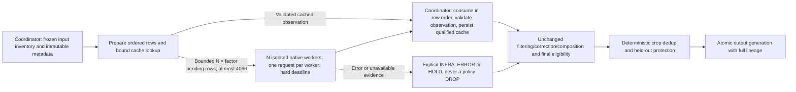

# Astra review: parallel filtering runtime and CSCS preparation

**Reviewer:** GPT-6 Astra (`gpt-6-astra`), extra-high reasoning. **Updated:** 2026-10-19 (Europe/Athens; original review dated 2026-10-18). **Scope:** filtering means, runtime reliability and preservation of the accepted scientific policy.

**Later production finding, 2026-10-19:** The first full-census attempt exposed evaluation split aliases during registration. The verified repair and completed all-five-parent preflight are recorded in the [split-repair addendum](ASTRA_CSCS_SPLIT_REPAIR_REVIEW_20261019.md), which supersedes this report’s input-readiness assertion. The performance evidence below remains historical evidence for the unchanged native implementation.

**Final verdict: READY for the bound diagnostic census on `6261c3f5…`, using 64 native workers and prefetch factor 64.** CS1–CS8 are closed. The final 6,144-row comparison completes in **55.44 seconds**, versus **65.78 seconds with factor 16**, with identical scientific results, fresh native observations and zero infrastructure/cache/unavailable-measurement/cleanup faults. The global pending limit remains 4,096 records. All 592,466 input rows, referenced assets, runtime and corrective artifact identities are preserved in the final configuration. **The full census remains unlaunched; automatic admission still requires the unresolved data evidence below.** [Final throughput](efficiency/throughput_03.json) [Final configuration binding](full-run-config-binding.json) [Performance review](ASTRA_CSCS_PERFORMANCE_REVIEW_20261018.md)

| Question | Verdict | Evidence boundary |
|---|---|---|
| Are the implementation findings closed? | **PASS** | CS1–CS8 closed; final source passes 240 lightweight regressions; native repair preservation is verified. |
| Is native parallel execution qualified? | **PASS on 768 and 6,144** | Fresh qualification and longer comparisons preserve ordered scientific results without faults; the selected 64-worker/factor-64 setting is measured in both. |
| Are complete-parent diagnostic inputs ready? | **PASS bindings** | Final configuration SHA `9d7e6c06…` binds the qualified source, selected settings, all five unchanged parents, verified crops/pages and unchanged runtime. |
| Has the full diagnostic census completed? | **NO—unlaunched** | No full-set retention, timing or coverage outcome is claimed. |
| Is all-row automatic admission ready? | **HOLD for data evidence** | Canonical editions, new-data splits, some orthography/profile evidence, complete applicable corrective coverage and the SF7 audit remain unresolved. |

The owner-accepted segmentation policy remains version 0.5. This review does not reopen its thresholds, require detector retuning or introduce training-design conditions. The parallel census runtime is version 0.4; source content, correction, composition and final-eligibility rules must retain their previously reviewed behavior. The earlier eight integration findings are tracked by their regression tests and the [completed filtering review][previous-review].

This reviewer performed lightweight source inspection and synthetic metadata/process checks only. No native crop, full dataset, OCR task, remote job or cluster allocation was processed by this review. Any Slurm smoke/performance evidence below must come from a separately identified execution receipt, not from the local concurrency tests.

## Architecture and preservation checks

The division of work is appropriate for this workload. The coordinator owns input registration, expectations, page summaries, cache lookup/write, correction import, pipeline evaluation and all SQLite transactions. Each executor thread owns a separate persistent `NativeWorker` subprocess; the threads orchestrate I/O while native image work happens in separate processes. Native requests are prefetched within the configured worker-count-times-factor window, then consumed in original row order. The current supported global bound is 4,096 pending records; factor 2 remains the default. That ordering preserves deterministic composition, deduplication and export behavior despite out-of-order native completion. [Pool][pool] [Coordinator][coordinator]

Worker subprocesses receive one-thread OpenMP/OpenBLAS/MKL/vecLib settings before startup, and the native adapter retains its OpenCV thread restriction. The existing complete-request deadline and process-group reset remain important: increasing the worker count must not multiply unbounded hung requests. Worker count is validated as an integer from 1 through 256; the final runtime also rejects combinations exceeding 4,096 pending observations. These controls establish bounded orchestration. The separate native receipts establish sample speedups; neither establishes a global node optimum or a full-corpus duration. [Native worker][worker]

The pipeline is intentionally conservative on unresolved metadata and tool coverage. Parallelism does not convert missing correction output to no-change, candidate releases to accepted releases or unknown geometry to a measured defect. A completed diagnostic census can contain held rows; it is not a certificate that every row is admissible.

## Findings

### CS1 — PASS after repair: cleanup attempts every worker and preserves the primary error

**Evidence.** `NativePool.close` initially stopped at the first exception from a worker's `close`. The census `finally` called it before writing runtime/progress receipts and closing the ledger, so that exception could skip the remaining cleanup and mask the original failure. [Pool cleanup][pool] [Census cleanup][coordinator]

**Reproduction.** Two tiny fake workers completed their observations. The first worker's cleanup raised a fixture exception. The recorded cleanup attempts were `[0]`: the second worker's cleanup was never attempted. No native image work was involved.

**Required closure.** Attempt cleanup of every created worker, collect cleanup errors without masking the primary failure, and ensure runtime/progress receipt and ledger cleanup execute independently. Test a worker-close failure both after successful evaluation and during a primary export/filtering failure. Any residual cleanup error must remain visible in the runtime receipt.

**Verified repair.** Pool cleanup now collects errors while visiting every instance. Nested coordinator cleanup attempts runtime/progress publication and closes the database even when cleanup fails. An otherwise successful invocation surfaces residual cleanup failures; an existing primary exception remains primary. The cleanup regressions pass in the independent 72-test pipeline run.

### CS2 — PASS after repair: invalid observations are quarantined before cache reuse

**Evidence.** The coordinator initially persisted a completed native result before `Pipeline.evaluate` checked the result's row/raw/crop/version bindings. Its explicit `--retry-errors` path then reused the cached invalid result. Cache serialization/validation also occurred outside the per-row exception handling. [Coordinator cache handling][coordinator]

**Reproduction.** A fake native worker returned a normal KEEP observation with the wrong raw-text hash. The first run produced one `INFRA_ERROR`, but saved the observation in the measurement cache. A retry using a healthy worker produced the same error: `native_attempts=0`, `cached_measurements=1`, and the healthy worker was never called.

**Required closure.** Validate the complete native result contract before persistence, including serializability, legal verdict and observation binding. Invalid cached records must be quarantined or evicted so explicit retry can obtain a new observation. Classify malformed evidence as an infrastructure/evidence failure for its row, with a durable reason; do not turn it into DROP or abort unrelated rows. Valid caches must still be reused without reprocessing.

**Verified repair.** A shared segmentation validator checks identity/raw-text/version bindings, legal verdict/reason and canonical serialization before persistence and on cache reads. The coordinator stores rejected evidence in `measurement_failures`; stale invalid cache records are removed and remeasured. Invalid new evidence becomes a row infrastructure error. Cache/retry regressions pass alongside the previous fail-closed and valid-cache reuse tests. [Shared native validator][native-validation]

### CS3 — PASS after repair: qualification requires fresh native work and a serial baseline

**Evidence.** The new qualification helper initially accepted arbitrary worker-count lists and named run directories only by worker count. Repeating a count reused the completed ledger; starting the list above one also silently changed the speedup baseline. The helper checked decision equality but did not require fresh native attempts for each run. [Qualification helper][qualification-helper]

**Reproduction.** With a tiny metadata-only native stub, worker counts `[1, 1]` produced a PASS qualification and a reported 1.39× “speedup.” The first run attempted its one observation; the second attempted zero because its completed decision was reused. Both cache-hit counters were zero, because the second run skipped the row entirely rather than consulting its measurement cache. The example is a validation counterexample, not a performance result.

**Required closure.** Require a clearly identified serial baseline, unique legal worker counts, fresh per-run directories, complete summaries and exactly one native attempt per sampled row in every measured run. Reject nonzero cache hits, invalid-cache reuse, unavailable measurements and cleanup errors in qualification. Decision equality alone cannot certify fresh computation. If arbitrary baseline counts are supported, label the ratio to that baseline explicitly rather than calling it serial speedup.

**Verified repair.** The helper requires positive sample size, a first count of one, unique integer counts in 1–64, new output directories, complete summaries and `native_attempts == sample_rows`. It rejects nonzero cached/invalid/unavailable/cleanup counters before publishing qualification. The five invalid-baseline/count cases pass their regression tests; inspection confirms the fresh-run and native-attempt gates. Original source-parent identity is retained in each sample row. The default comparison is 1, 4 and 8 workers.

### CS4 — PASS after deployment repairs: original crop paths and reconstructed bytes retain their established contracts

**Evidence and observed failures.** These defects were found by remote execution, not by this review's synthetic tests. The deployment agent reports that job 3692566 stopped before native processing because the original-v2 crop helper discarded the wave directory. Attempt 2, job 3692591, then measured 16 original-v2 crops but rejected all 32 selected W1/W2 reconstructions at the strict frozen-crop SHA check. The new loader had omitted the original collector's conversion to grayscale. These failures demonstrate why saved-policy replay and metadata tests were insufficient for native runtime qualification. I inspected the saved attempt-2 aggregate receipt: 48 native attempts, 12 HOLD, four DROP and 32 INFRA_ERROR, all 32 carrying the reconstructed-crop hash failure. It records zero cached observations and cleanup errors. The attempt-1 outcome remains attributed to the deployment agent. [Attempt-2 failure receipt][failure-02] [Attempt-2 submission][submission-02]

**Verified repair.** The original-v2 mapping now uses unchanged copies of `rewrite_crop` and `physical_crop` from the established preparation helper. I compared both function ASTs against that source, verified its SHA-256, and inspected the regression preserving the wave directory and rejecting traversal. The W1/W2 reconstruction now performs `page.convert("L").crop(box)` and PNG encoding with `compress_level=3`, matching the existing collector's `ensure_crop`; the strict source and final crop hashes remain mandatory. Context/crop congruence compares the source crop in the delivered crop's mode. Source-context detection still receives the original page mode, and the segmentation decision policy is unchanged. A tiny synthetic color fixture verifies the grayscale bytes and mode-aware congruence without processing corpus images. [Path adapter][crop-paths] [Established path functions][original-paths] [Existing crop writer][original-crop] [Native loader][native-loader] [Regressions][loader-tests]

**Closure evidence.** The source contract and regressions pass; after the codec repair in CS5, both the original and W1/W2 crops completed strict native reconstruction in the 48-row qualification. The broader context-handling defect is tracked separately in CS6.

### CS5 — PASS after repair: exact PNG codec and enforced runtime binding

**Observed evidence.** Job 3692613 attempted 48 rows and again produced 12 HOLD, four DROP and 32 INFRA_ERROR, all with `reconstructed crop bytes differ from frozen crop hash`. The worker probe reports Pillow's zlib backend as `1.2.13`. None of its four rows matched the frozen crop hash across the tested L/RGB modes and PNG compression levels 0, 1, 3, 6 or 9. One probe row has a preexisting original PNG whose SHA exactly matches the frozen target, providing a concrete original-byte witness. The deployment agent reports the producing Mac used `1.3.1.zlib-ng` with backend 2.3.3; the local probe log directly establishes the CSCS side only. These observations support a codec-compatibility hypothesis, not yet a proved single cause. [Attempt-3 failure][failure-03] [Codec probe][codec-probe]

**Verified deployment repair.** A private zlib-ng 2.3.3 build with zlib-compatible ABI is used through process-local `LD_PRELOAD`, preserving the frozen source hashes, grayscale conversion and strict final crop SHA. The build script does not modify the accepted policy or substitute a looser pixel-only identity check. Its frozen-byte matches and successful native qualification establish compatibility for the tested rows. The loaded library hash and build receipt identify the worker runtime; a version string alone was not treated as sufficient evidence. [Private codec build script][codec-build]

**Verified codec progress.** The private build's saved probe reports `1.3.1.zlib-ng`. I parsed its four result records: **4/4 `L/3` hashes exactly equal the frozen targets**, including the existing original W1 PNG witness. This verifies the reconstruction repair on those four rows. It does not yet verify the full 48-row sample or the serial/parallel native-worker chain. [Successful codec probe][codec-probe-fixed]

**Runtime-binding repair inspected.** The new runtime module captures Python, package and compiled-module identities, loaded codec libraries, preloads, executable files and thread settings. The coordinator validates its manifest before opening the ledger; the manifest SHA enters the run binding and measurement key. Native subprocess startup revalidates the manifest, and the wrapper checks the private codec SHA before setting `LD_PRELOAD`. All 94 pipeline tests pass independently, including drift-before-ledger, changed-manifest resume rejection, actual executable selection and manifest propagation. [Runtime capture/validation][runtime-binding] [Native startup][native-worker-start]

**Final enforcement verified.** Production native execution now requires a runtime manifest. Before opening the ledger, the coordinator validates PATH-resolved Node and the actual predictor argument against that manifest. The native subprocess repeats that check and invokes the validated resolved paths. Thus a fully cached resume cannot bypass changed executable selection merely because no child starts. Injected metadata-test workers remain exempt from the production requirement. Missing-manifest and actual-executable regressions pass. The manifest SHA binds both the ledger and measurement keys; old runtime observations cannot silently qualify a changed native environment.

**Native evidence.** Attempt 4 completed the full selected 48-row sample at 1/4/8 workers, including strict W1/W2 reconstruction, with identical ordered decisions and no infrastructure or cache faults. It preceded the final mandatory-manifest/actual-path enforcement changes; the final-bundle 192-row qualification subsequently passed with those checks active. The scientific filtering policy and codec recipe are unchanged. [Attempt-4 qualification][qualification-04]

### CS6 — PASS after source and native-witness repair: existing invalid-envelope dependencies restored

**Observed evidence.** The broader 192-row serial run completed 192 fresh native attempts but produced one INFRA_ERROR for `lekythos--3bfc4a385d61b883--s004-l0129`: `invalid_detector_geometry`. There were no cache hits, invalid-cache entries or cleanup errors. A separate final-source 48-row smoke passed; that narrower success does not erase the broader failure. The inspected receipt preserves both results. [Broader failure and final-source smoke][broad-05]

**Implementation mismatch.** Native context calls `ownership.prepare_row` directly and supplies `invalid_rows=[]` to `supported_rows`. The established cached-page adapter instead validates row identity/components/body guides and arrays, quarantines only a nonpositive top/bottom envelope, and passes the quarantined rows to `invalid_geometry_dependencies`. That existing dependency check makes affected target/crop/direct-neighbour evidence unavailable while allowing unrelated invalid rows to remain explicitly recorded. Native context must use the same contract rather than treating every inverted envelope as a whole-request infrastructure failure. [Existing validator][geometry-validator] [Dependency checks][geometry-dependencies]

**Precise repair boundary.** Extract and share that exact per-row validation/quarantine behavior between cached and native observations. Keep structural identity, component membership, positive body-guide, finite array and horizontal-bound failures strict. Do not catch all geometry exceptions or drop invalid rows from the dependency evidence. Preserve row IDs/counts, and test unrelated versus overlapping/direct-neighbour invalid envelopes plus strict corruption cases. The inspected worker witness confirms row `row-00031` has xheight 9, eight finite arrays of length 100 and 19 nonpositive-envelope columns, with minimum bottom-minus-top −7.873. The shared `prepare_geometry_row` helper now retains the cached path's existing body/curve checks and exact narrow quarantine, and native context passes invalid IDs/counts into the unchanged dependency check. The metadata regression covers unrelated, overlapping and direct-neighbour cases plus malformed body guides, shapes and nonfinite arrays. All **220 pipeline/CP2/CP3/CP4c tests pass independently in 2.45 seconds**. Strict source hashes and the accepted JavaScript policy are unchanged. The repaired worker receipt preserves all 191 previously measurable verdict/reason pairs with zero changes. The former error row is measured KEEP, retaining four quarantined context-row IDs as unrelated under the existing dependency check. Both 192-row serial and four-worker passes now complete with zero infrastructure errors; the separate timing-comparison issue is CS7. [Native geometry witness][geometry-witness] [Repair witness][geometry-repair-witness]

### CS7 — PASS comparison repair: ignore only the incidental orientation timer

The next broad comparison records four changed rows, each differing only at `segmentation.result.frame.orientation.evidence.seconds`. Both runs measured all 192 rows without cache, unavailable or cleanup faults. These elapsed times are expected to vary with scheduling; they are not an orientation angle, geometry value or filtering decision. [Exact comparison differences][parity-07]

The qualifier now compares a deep copy that removes only `run_binding_sha256` and this precise orientation timing leaf on segmentation stages. Original decision records remain intact and every other field is retained, including differently located `seconds` fields. Regressions verify that changing elapsed time preserves equality but changing an angle, verdict or geometric value still fails; `orientation=None` is preserved without error. The complete pipeline/CP2/CP3/CP4c suite passes **221 tests in 2.68 seconds**, independently run by this reviewer. No native runtime or scientific policy change is involved. The fresh 192-row comparison now passes at all four worker counts under this explicit comparison contract. [Final native qualification][qualification-08]

### CS8 — PASS: empty context refit conservatively excluded; 768-row parity verified

The expanded serial probe attempted all **768 rows** with zero cache hits, invalid-cache entries, unavailable measurements or cleanup faults, but one INFRA_ERROR: `lekythos--dcfa99599048d352--s002-l0114`, `expected non-empty vector for x`. Its measured filtering/export boundary is 145.25 seconds. The saved worker trace locates the error in the second `np.polyfit` of `greekocr.pages.pixels._direct_rules`, called during source-context detection, after the refit has no supporting contacts. This is distinct from the nonpositive-envelope issue in CS6. [Larger failure receipt][scaling-failure] [Exact traceback][empty-fit-trace]

**Verified narrow repair boundary:** classify only the exact built-in TypeError/message whose traceback contains the actual pinned `_direct_rules` function code, only around source-context `process_page`. Return explicit `status=unavailable`, `reason=empty_oblique_rule_refit` and the original error diagnostic. Preserve every detector byte and all other exceptions. The frozen reconciliation and decision policy can then conservatively exclude unresolved context without inventing a fit or skipping a candidate to obtain KEEP. The inspected synthetic test executes the real `_direct_rules` path on a tiny support plane and forces the second real fit to receive zero contacts; the identical message outside that function remains an error. The current complete pipeline/CP2/CP3/CP4c suite independently passes **235 tests in 2.34 seconds**. Candidate `f9e06adc…` archive, all 319 files and current source equality are verified. Detector and accepted-policy bytes remain unchanged.

**Same-768 serial preservation: PASS.** The inspected worker receipt binds exact before/after sample, decision, config, registry and source-manifest hashes and equal ordered unique row identities. All **767 previously successful full scientific records remain identical** after narrowly removing changed source fingerprints and the existing orientation timer. The content-repair route digest is removed only after validating it against each respective frozen registry; all substantive route fields remain compared. The former infrastructure error is now **HOLD / UNCERTAIN**, with `empty_oblique_rule_refit` and its original TypeError diagnostic retained. No new infrastructure error appears. I independently checked both registry hashes and adversarially checked the comparator: verdict, angle, geometry, unrelated time fields, route status and segmentation-version mutations remain unequal; a wrong route digest is rejected. [Repair preservation receipt](efficiency/repair-preservation.json) [Exact comparator](efficiency/compare_empty_fit_repair.py)

**Expanded parallel closure: PASS.** Job **3692889** on `nid006251` measures the same 768 frozen rows at serial/factor 2 and all nine combinations of 16/32/64 workers with factors 2/8/16. Every case makes 768 fresh attempts, reports zero infrastructure/cache/unavailable/cleanup faults, and has the same scientific digest `58110aa9…`. The parallel comparator still excludes only run identity and the precise orientation clock; the broader source-fingerprint exclusions apply solely to the cross-generation repair proof. Each case reports 601 segmentation KEEP, 139 UNCERTAIN and 28 DROP; final dispositions remain 740 HOLD and 28 DROP because benchmark metadata/correctives are deliberately incomplete. This closes CS8 and qualifies the runtime candidate for diagnostic use. The subsequent 6,144-row pilot also passes at 32/64 workers with exact equality and zero faults (63.00 seconds at 64 workers). The subsequent cap-256 candidate also passes a fresh seven-case 768-row comparison with 256-CPU affinity; the later high-worker and fixed-worker queue comparisons are complete and select 64 workers/factor 64, as detailed in the performance review. The full census remains unlaunched. [Longer pilot](efficiency/throughput_01.json) [Expanded parallel receipt](efficiency/scaling_02-qualification.json)

## Restart, cohort and throughput boundaries

Resume must preserve the exact run binding and reuse only validated observations. The worker count is part of that binding: changing concurrency requires a new run configuration/ledger rather than silently reusing decisions under a different runtime receipt. Benchmark comparisons should therefore use explicitly separate runs, the same frozen rows and scientific inputs, and compare complete ordered scientific records after excluding only the intentionally different run fingerprint and the segmentation orientation elapsed-time leaf identified in CS7. Raw records retain both fields.

The bounded prefetch window can wait behind a slow earlier row. That is a deliberate resource/order tradeoff, not evidence of a scientific difference. Speed claims require measured end-to-end wall time, actual observations attempted versus cached, errors/unavailable cases, worker count, CPU allocation and the exact sampled parent. Tiny metadata fixtures demonstrate concurrency and equivalence, not native throughput.

The original parent and W1/W2 collection snapshots remain distinct populations. The runner must register every selected row and preserve source/book/edition/page/split identity; neither a benchmark subset nor the existing 888 saved segmentation observations is the whole census. Keep raw denominators, completed decisions, missing evidence, pending corrective routes, deduplication and final retained unique rows visible separately.

## Verification and deployment evidence

The implementation agent initially reported 75 passing tests: 65 pipeline tests and 10 existing CP4c regressions. This reviewer independently reproduced CS1/CS2, inspected their repairs and ran an intermediate 72-test suite. The CS3 reproduction used only a metadata stub. Before CS6, **94 pipeline tests passed independently in 1.47 seconds**, including previous F1–F8 regressions, single/parallel ordered-decision parity, coordinator ownership, queue bounds, faults, retries and helper baseline guards. The implementation agent separately reported **104 total passing tests** at that point, adding 10 existing CP4c regressions. After CS6, I independently ran the expanded **220-test** pipeline/CP2/CP3/CP4c suite; all passed in 2.45 seconds. [Tests][tests] [Exact snapshot receipt][receipt]

The wrapper is a thin adapter around a byte-pinned copy of the established OCR `common.sh`/`run_step` in the immutable bundle. It verifies `SHA256SUMS`, requests one debug node with 16 CPUs per task and a 45-minute wall limit, then runs offline locked Rust compilation, integration tests and saved-evidence parity before invoking the selected worker mode. I inspected the helper and confirmed `bash -n` passes. The deployment agent reports that the first attempt passed 77 worker-side tests, a six-second Rust build and the 888-decision/184-context saved-evidence replay before encountering the crop-path defect. This is partial worker evidence, not successful native qualification. [Slurm payload][slurm] [Existing OCR helper][common]

The Node bootstrap selects an official Node 22 LTS archive, verifies its published SHA-256, records the runtime path/hash and checks the reported version. The supplied bootstrap log records Node **v22.23.3**, its ARM64 archive/runtime hashes and fetched Cargo dependencies. The worker rechecks the Node hash, package versions, OpenCV thread behavior and the tool registry; it fingerprints the predictor. I inspected the saved log without executing bootstrap or fetching software. A download receipt does not establish a successful native pipeline run. [Bootstrap][bootstrap] [Bootstrap log][bootstrap-log] [Worker environment][qualification-helper]

The user-referenced Clariden operating rules specify debug for short one-node metadata/smoke jobs and require checking current partition/QoS limits before relying on them. The deployment agent reports a live `MaxTime=01:30:00` partition check; independently inspected receipts show the exact 45-minute request passed `sbatch --test-only`, was submitted as job 3692566 and was allocated one node on debug. The allocation receipt identifies **QoS normal**, 16 requested CPUs per task and a whole-node allocation of **288 CPUs and four GPUs**. Those are the observed job properties; a separate debug-QoS limit must not be attributed to this job by assumption. No Apertus training-specific architecture or checkpoint contract is imposed on this OCR payload. [Applicable Clariden rules][clariden-rules] [Test-only receipt][slurm-test] [Submission][submission] [Allocation snapshot][allocation]

The bundle supporting the earlier 192-row qualification has manifest hash `fd4d5e20283b4f1b55910872a17e36dd2f601d99b13111d92305ddc141d7d04a`. I verified its archive hash, manifest hash, every payload entry and the reviewed code's equality to its archived copy. The package contains 319 files in 7,692,756 compressed bytes. Earlier bundles belong to earlier attempts. The later performance/CS8 candidate is separately pinned in the performance review. The final source includes census-only resume, explicit retry flags, the shared existing invalid-envelope handler and the exact comparison normalization. Native/census/shared-geometry/accepted-JavaScript bytes are identical to the preceding `2527901a…` bundle; only the qualifier comparison changed in the final step. Executable code matches the reviewed archive. The receipt separately preserves those deployment stages. [Preserved deployment source receipt][receipt]

The attempt-1 allocation snapshot above records an intermediate running state, not the outcome. The deployment agent subsequently reported job 3692566 failed after 26 seconds before native processing. Its unusable dependent inventory job was cancelled. Attempt 2 was submitted as job 3692591, and exposed the grayscale-loader defect described in CS4. The independent metadata inventory was submitted as job 3692596 on bundle `aea11804…` with an `afterany` dependency; its metadata/hash/asset-enumeration purpose does not exercise the repaired native loader. The independent inventory now has a completed metadata receipt, summarized below. The repaired native qualification was submitted as job **3692613** with bundle `44012fe4…`; its submission succeeded, but its saved native result failed qualification with 32 reconstruction errors (CS5). [Attempt-2 submission][submission-02] [Independent inventory submission][inventory-02] [Attempt-3 submission][submission-03]

The deployment agent reports that the frozen W1/W2 metadata snapshots were transferred to `/iopsstor/scratch/cscs/fffoivos/greek-ocr-e3/filter_pipeline_20261018/inputs/collect-v3-data/snapshots`. That is a reported staging action, not a native qualification result independently inspected here. The submitted qualification plans 48 rows: 16 original collection-v2 crops and 16 each from W1/W2, with new-data source-page reconstruction. Unresolved edition/split metadata stays unresolved. The helper requires every sampled row to obtain native measurement, at least one segmentation KEEP and exact ordered decision equality before publishing PASS. Selection by available files is a functionality/performance sample, not a population-quality sample.

The saved full metadata inventory contains **592,466 rows in five explicit parents**: original collection-v2 train 214,436, dev 13,522, test 44,029, W1 101,098 and W2 219,381; it observes 1,917 books. These are inventory denominators, not admitted rows. The receipt binds each parent hash and reports 4,130 referenced source pages, only two verified on the worker at inventory time and 4,128 missing. Its explicit flags are `complete_correction_coverage=false` and `full_native_census_executed=false`. This closes metadata enumeration for those frozen parents; it does not prove complete source-context geometry, correction coverage or final retention. The staging plan lists all 4,128 missing assets as locally available and 3,601,746,623 bytes; the later full-preparation receipt verifies staging completion and all worker source hashes (see below). [Inventory receipt][inventory-result] [Source staging plan][stage-plan]

**Earlier 192-row native qualification: PASS; larger-run failure is CS8.** I inspected attempt 8 from job **3692777** on `nid007645`, using bundle `fd4d5e20…`. The sample contains 192 rows: 64 each from the complete original-v2 train, W1 and W2 parents selected by deterministic SHA priority. Each worker-count run makes 192 fresh native attempts, with zero cache hits, invalid-cache entries, unavailable observations, infrastructure errors or cleanup failures. Every run reports **145 segmentation KEEP, 38 UNCERTAIN and nine DROP** and the same ordered scientific-decision digest. The only comparison exclusions are the run-binding hash and the precise segmentation orientation elapsed-time leaf; raw decisions preserve both. [Final qualification receipt][qualification-08]

| Workers | Whole `run()` wall time | Relative to one worker |
|---|---:|---:|
| 1 | 44.364 s | 1.00× |
| 4 | 22.079 s | 2.01× |
| 8 | 18.213 s | 2.44× |
| 16 | 13.213 s | **3.36×** |

Sixteen workers were the fastest measured choice in this historical 192-row comparison and were selected in its archived preparation. The final selection is 64 workers/factor 64, based on the larger comparisons in the performance review. These are same-sample measurements, not a statistically established corpus throughput estimate or proof of a globally optimal worker count. Filesystem warming, startup costs, source-context frequency and row latency tails can affect full execution. `runtime.json.filtering_and_export_seconds` is narrower than the whole-call boundary above. The parent-balanced SHA sample is not explicit class/source stratification, despite the CLI flag `--stratified`.

Final qualification dispositions are **183 HOLD and nine DROP** because the benchmark intentionally has no completed corrective/edition metadata. A native segmentation KEEP is not automatic admission. The earlier 48-row attempt passed at 1/4/8 workers with a 1.62× best measured ratio; that prefix sample is historical functionality evidence, while the 192-row comparison was the stronger evidence at that stage. The final performance review supersedes both for runtime selection. Neither sample establishes full-set keep rate. [Earlier qualification][qualification-04]

## Full-input preparation review

The prepared diagnostic mode verifies every referenced source page against its frozen hash and binds every original-v2 crop's actual path and SHA in batches of 1,000 with at most 16 hashing threads. Missing source pages or original crops abort preparation before issuing a run configuration. Original parent JSONL bytes and hashes are preserved, so correction-parent identity is not rewritten by crop-path adaptation. Explicit crop metadata supplies the physical wave directory. Original parent split declarations are a fallback when the row has no split; row/book/explicit row metadata retain their documented precedence. Unknown new-data split and edition identities remain unknown. [Preparation helper][prepare-helper] [Source adapter][sources]

I checked the existing release manifests: RU1's sparse 680-row output binds raw v2-train parent SHA `5c5429a4…`, exactly matching the prepared train parent; N1's 629-row W1 output identifies input SHA `c85b407a…`, exactly matching the frozen W1 parent. Their output hashes match the frozen bundled artifacts. SF7 is train-only and remains `candidate_pre_audit`; preparation preserves that status. Sparse omissions still cannot become verified no-change, original holds survive import, and unknown Russian orthography cannot become permission to apply RU1. [RU1 manifest][ru1-manifest] [N1 manifest][n1-manifest] [SF7 handoff][sf7-handoff]

Preparation captures the same runtime manifest used by actual worker validation and records unresolved canonical editions, new-data splits, insufficient book/page orthography, full applicable correction coverage and SF7 audit status. These omissions permit a conservative diagnostic census with explicit HOLD rows; they do not permit an automatic-admission release. The inspected complete preparation receipt now verifies **271,987 original crop bindings, all 4,130 referenced source pages and zero missing originals** across 592,466 rows. I compared all five `(parent ID, SHA, row count)` triples with the earlier frozen inventory: all match exactly. Its frozen metadata SHA is `b5ff259b…` and runtime-manifest SHA is `84ed3add…`. This preparation ran on bundle `96e82c64…`; the final rebound config points to qualified bundle `6261c3f58cc80e1bbfe70e35120aa9d9e8c388fa0dbc0a8f62f17a8d1045bf35` while preserving the original data, metadata and runtime bindings. I compared all five complete parent dictionaries with the archived full configuration, and every corrective binding apart from its relocated source path: parent hashes, artifact hashes and release statuses are unchanged. The local full-config SHA exactly equals the binding and plan: `9d7e6c0607e96628aac40415d11201fbd97f4ade9157c4043fcd2990c0131600`. Metadata SHA remains `b5ff259b83ff2763f83f1b534f18ca7cf41d7158e5a1e5bce84c78bb71700696`; runtime SHA remains `84ed3add6190afe57198a9654bd16a0fc9464126d6c09a14cc5cd3e5f0ca68a4`. The earlier fd4 configuration is archived under `historical_fd4/`. [Config rebinding][config-binding] [Full config][full-config] Preparation does not prove a census has run or that correction import/application has completed across every parent. [Full input binding][full-binding]

The final wrapper permits an existing output directory only for `census`; preparation and qualification remain fresh-output-only. Both `--retry-errors` and `--retry-holds` default off and pass through to the census implementation. A metadata-only CLI probe verified all four flag combinations without executing a run. Resume continues to validate exact source/config/data/runtime identity before reuse; changed bindings require a new run directory. This establishes resumed invocation correctness, not an observed interrupted full-census recovery on CSCS.

The final launch plan uses **64 native workers, prefetch factor 64, 4,096 pending observations, 256 requested task CPUs, one node, account a0140, normal partition and a six-hour limit**. Requested CPU affinity matches the final qualification. The exact request passed `sbatch --test-only`; the receipt explicitly records `full_census_submitted=false` and `training_submitted=false`. The unexecuted launch script checks the selected remote config SHA before submission, and its shell syntax passes. The retry command is the same bound invocation plus `--retry-errors`; source/data/runtime binding refusal and publication-generation safeguards remain active. No interrupted full-census recovery on CSCS has been claimed from the metadata tests. The selected 6,144-row throughput extrapolates arithmetically to **1.49 hours** for 592,466 rows. The plan's **2–3 hours** is a provisional planning assumption, excluding queue time; the six-hour allocation is a ceiling, not an ETA. The full population has different parent weights, additional original dev/test rows, and unmeasured tails or retries. No population timing guarantee follows from these pilots. [Prepared launch and resume commands][full-plan]

This is readiness for a conservative diagnostic census that records admitted, dropped, held and failed rows with lineage. It is not a claim that all rows already have sufficient evidence for automatic admission, that every population has been natively measured, or that full-corpus retention and runtime are known. The census must preserve raw denominators and source/class/script/split breakdowns, expose pending corrective queues, and leave unresolved metadata and release audits as exclusions. Those remaining evidence outputs do not reopen the owner-accepted segmentation policy or introduce training-design conditions.

[previous-review]: /Users/foivoskarounos-zamparloukos/Projects/ocr-review-sites-20261018/docs/ASTRA_FILTER_PIPELINE_FIX_REVIEW_20261018.md
[pool]: /Users/foivoskarounos-zamparloukos/Projects/greek-ocr-toolkit-sol-recut/greekocr/harvest/line_pipeline_parallel.py
[coordinator]: /Users/foivoskarounos-zamparloukos/Projects/greek-ocr-toolkit-sol-recut/greekocr/harvest/line_pipeline_census.py:322
[worker]: /Users/foivoskarounos-zamparloukos/Projects/greek-ocr-toolkit-sol-recut/greekocr/harvest/line_pipeline_native.py:203
[native-validation]: /Users/foivoskarounos-zamparloukos/Projects/greek-ocr-toolkit-sol-recut/greekocr/harvest/line_pipeline.py:230
[qualification-helper]: /Users/foivoskarounos-zamparloukos/Projects/greek-ocr-toolkit-sol-recut/scripts/harvest/clariden/worker.py:84
[receipt]: /Users/foivoskarounos-zamparloukos/Projects/greek-ocr-toolkit-sol-recut/docs/harvest/line_pipeline/clariden/ASTRA_CSCS_REVIEW_20261018.json
[tests]: /Users/foivoskarounos-zamparloukos/Projects/greek-ocr-toolkit-sol-recut/tests/test_line_pipeline.py:524
[slurm]: /Users/foivoskarounos-zamparloukos/Projects/greek-ocr-toolkit-sol-recut/scripts/harvest/clariden/filter_worker.sbatch
[common]: /Users/foivoskarounos-zamparloukos/Projects/greek-page-ocr-wave2/scripts/clariden/common.sh:40
[bootstrap]: /Users/foivoskarounos-zamparloukos/Projects/greek-ocr-toolkit-sol-recut/scripts/harvest/clariden/bootstrap.py
[clariden-rules]: /Users/foivoskarounos-zamparloukos/.claude/skills/optimize-apertus-cscs/SKILL.md:148
[deployment]: /Users/foivoskarounos-zamparloukos/Projects/greek-ocr-toolkit-sol-recut/docs/harvest/line_pipeline/clariden/deployment-source.json
[submission]: /Users/foivoskarounos-zamparloukos/Projects/greek-ocr-toolkit-sol-recut/docs/harvest/line_pipeline/clariden/qualification-submission.json
[allocation]: /Users/foivoskarounos-zamparloukos/Projects/greek-ocr-toolkit-sol-recut/docs/harvest/line_pipeline/clariden/allocation.txt
[slurm-test]: /Users/foivoskarounos-zamparloukos/Projects/greek-ocr-toolkit-sol-recut/docs/harvest/line_pipeline/clariden/slurm-test-only.json
[bootstrap-log]: /Users/foivoskarounos-zamparloukos/Projects/greek-ocr-toolkit-sol-recut/docs/harvest/line_pipeline/clariden/bootstrap.log

[crop-paths]: /Users/foivoskarounos-zamparloukos/Projects/greek-ocr-toolkit-sol-recut/scripts/harvest/clariden/filter_crop_paths.py:9
[original-paths]: /Users/foivoskarounos-zamparloukos/Projects/greek-page-ocr-wave2/bench/e3_prepare.py
[original-crop]: /Users/foivoskarounos-zamparloukos/Projects/greek-ocr-toolkit-sol-collect/collect_v3/storage.py:90
[native-loader]: /Users/foivoskarounos-zamparloukos/Projects/greek-ocr-toolkit-sol-recut/greekocr/harvest/line_pipeline_native.py:35
[loader-tests]: /Users/foivoskarounos-zamparloukos/Projects/greek-ocr-toolkit-sol-recut/tests/test_line_pipeline.py:674
[submission-02]: /Users/foivoskarounos-zamparloukos/Projects/greek-ocr-toolkit-sol-recut/docs/harvest/line_pipeline/clariden/qualification-submission-02.json
[inventory-02]: /Users/foivoskarounos-zamparloukos/Projects/greek-ocr-toolkit-sol-recut/docs/harvest/line_pipeline/clariden/inventory-submission-02.json

[failure-02]: /Users/foivoskarounos-zamparloukos/Projects/greek-ocr-toolkit-sol-recut/docs/harvest/line_pipeline/clariden/native-attempt-02-failure.json
[submission-03]: /Users/foivoskarounos-zamparloukos/Projects/greek-ocr-toolkit-sol-recut/docs/harvest/line_pipeline/clariden/qualification-submission-03.json
[inventory-result]: /Users/foivoskarounos-zamparloukos/Projects/greek-ocr-toolkit-sol-recut/docs/harvest/line_pipeline/clariden/inventory/inventory.json
[stage-plan]: /Users/foivoskarounos-zamparloukos/Projects/greek-ocr-toolkit-sol-recut/docs/harvest/line_pipeline/clariden/inventory/source-stage-plan.json

[failure-03]: /Users/foivoskarounos-zamparloukos/Projects/greek-ocr-toolkit-sol-recut/docs/harvest/line_pipeline/clariden/native-attempt-03-failure.json
[codec-probe]: /Users/foivoskarounos-zamparloukos/Projects/greek-ocr-toolkit-sol-recut/docs/harvest/line_pipeline/clariden/crop-probe.log
[codec-build]: /Users/foivoskarounos-zamparloukos/Projects/greek-ocr-toolkit-sol-recut/docs/harvest/line_pipeline/clariden/build_png_codec.sbatch

[codec-probe-fixed]: /Users/foivoskarounos-zamparloukos/Projects/greek-ocr-toolkit-sol-recut/docs/harvest/line_pipeline/clariden/png-codec-probe.log
[runtime-binding]: /Users/foivoskarounos-zamparloukos/Projects/greek-ocr-toolkit-sol-recut/greekocr/harvest/line_pipeline_runtime.py:24
[native-worker-start]: /Users/foivoskarounos-zamparloukos/Projects/greek-ocr-toolkit-sol-recut/greekocr/harvest/line_pipeline_native.py:271

[qualification-04]: /Users/foivoskarounos-zamparloukos/Projects/greek-ocr-toolkit-sol-recut/docs/harvest/line_pipeline/clariden/qualification-04.json
[prepare-helper]: /Users/foivoskarounos-zamparloukos/Projects/greek-ocr-toolkit-sol-recut/scripts/harvest/clariden/worker.py:143
[sources]: /Users/foivoskarounos-zamparloukos/Projects/greek-ocr-toolkit-sol-recut/greekocr/harvest/line_pipeline_sources.py:15
[ru1-manifest]: /Users/foivoskarounos-zamparloukos/Projects/greek-ocr-toolkit-secondary/artifacts/ru1/ru1_v3_edits_manifest.json:3
[n1-manifest]: /Users/foivoskarounos-zamparloukos/Projects/greek-ocr-toolkit-secondary/artifacts/n1/n1_v1_w1_manifest.json:109
[sf7-handoff]: /Users/foivoskarounos-zamparloukos/Projects/greek-ocr-toolkit-spellcheck/docs/labelfix/spellcheck/HANDOFF_20261018_spellcheck.md:13

[full-binding]: /Users/foivoskarounos-zamparloukos/Projects/greek-ocr-toolkit-sol-recut/docs/harvest/line_pipeline/clariden/full-input-binding-01.json

[broad-05]: /Users/foivoskarounos-zamparloukos/Projects/greek-ocr-toolkit-sol-recut/docs/harvest/line_pipeline/clariden/broad-attempt-05.json
[geometry-validator]: /Users/foivoskarounos-zamparloukos/Projects/greek-ocr-toolkit-sol-recut/greekocr/harvest/geometry_observations.py:122
[geometry-dependencies]: /Users/foivoskarounos-zamparloukos/Projects/greek-ocr-toolkit-sol-recut/greekocr/harvest/geometry_observations.py:164

[geometry-witness]: /Users/foivoskarounos-zamparloukos/Projects/greek-ocr-toolkit-sol-recut/docs/harvest/line_pipeline/clariden/geometry-probe.log

[geometry-repair-witness]: /Users/foivoskarounos-zamparloukos/Projects/greek-ocr-toolkit-sol-recut/docs/harvest/line_pipeline/clariden/geometry-repair-witness.json
[parity-07]: /Users/foivoskarounos-zamparloukos/Projects/greek-ocr-toolkit-sol-recut/docs/harvest/line_pipeline/clariden/broad-attempt-07-parity-failure.json

[qualification-08]: /Users/foivoskarounos-zamparloukos/Projects/greek-ocr-toolkit-sol-recut/docs/harvest/line_pipeline/clariden/qualification-08.json
[config-binding]: /Users/foivoskarounos-zamparloukos/Projects/greek-ocr-toolkit-sol-recut/docs/harvest/line_pipeline/clariden/full-run-config-binding.json
[full-config]: /Users/foivoskarounos-zamparloukos/Projects/greek-ocr-toolkit-sol-recut/docs/harvest/line_pipeline/clariden/full-run-config.json
[full-plan]: /Users/foivoskarounos-zamparloukos/Projects/greek-ocr-toolkit-sol-recut/docs/harvest/line_pipeline/clariden/full-run-plan.json

[scaling-failure]: /Users/foivoskarounos-zamparloukos/Projects/greek-ocr-toolkit-sol-recut/docs/harvest/line_pipeline/clariden/efficiency/scaling-failure.json
[empty-fit-trace]: /Users/foivoskarounos-zamparloukos/Projects/greek-ocr-toolkit-sol-recut/docs/harvest/line_pipeline/clariden/efficiency/empty_fit_probe.log
