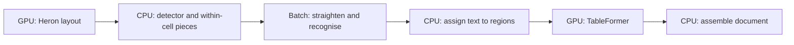

# GPU design after Q4

The useful mapping is a hybrid pipeline. Image filters, local weighted fits and
line resampling are array operations. The whole detector is not one matrix
multiplication: it also makes ordered, discrete decisions about components,
peeling, neighbours, marks and table entries. Preserve those decisions on the
CPU and batch independent array work around them.

**This is a design and an opt-in experiment, not a GPU production backend.**
The [Q5 report](../reviews/PAGE_LINES_Q5_GPU.md) gives the actual measurements,
numerical failures and device availability. No CUDA speedup is inferred from a
CPU or MPS number.

## What Q4 actually leaves

[Q4](../reviews/PAGE_LINES_Q4_SPEED.md) measured 95 pages, including the 54 Q5
development pages. Single-worker API time totalled 1,010.667 s. Line finding
used 275.272 s (27.2%), statistics 228.859 s (22.6%), table delivery 183.752 s
(18.2%), pixel preparation 152.489 s (15.1%) and checks 76.263 s (7.5%). These
are exclusive stage totals, not additive medians. Much of each stage is not a
dense tensor operation.

The retained Q4 profile of `an-d83e7a198ade-p000099` measured 10.054 s with
profiler overhead: local guide smoothing 0.595 s, rule-mask construction 0.422 s,
line extraction 0.322 s, binarisation 0.518 s, connected-component labelling
0.330 s and glyph `_measure` 0.938 s. The three prototypes target guide WLS,
rectangular morphology inside rule construction, and straightening. Morphology
is only part of 0.422 s; WLS is only part of guide fitting. None of those times
can be claimed as the saving from porting its whole enclosing stage.

## Stage-by-stage array mapping

| Stage | Q4 computation | Array form and placement |
|---|---|---|
| Binarisation | Reflect-border box means of gray and gray squared, Sauvola comparison, global quantiles, paper MAD, faint-component additions and shading rejection | Box filters are separable convolution or prefix sums; variance, square root and comparisons are elementwise. Histograms/reductions implement quantiles. Keep faint-component eligibility, connectivity and distance/edge predicates on CPU initially. Q4's proven stable-peel mask shortcut remains; do not replace crop-local thresholds with one page threshold. Float32 near thresholds needs an exact mask comparison before adoption. |
| Morphology | Rectangular opening/closing, extrema filters, dilation/erosion; thin-rule and slope tests | Max/min pooling is algebra over the max/min semiring, not ordinary linear algebra. Prototype uses separable pooling with explicit zero borders and Q4's different even-kernel erosion/dilation anchors. Bucket equal mask dimensions and kernel sizes. CPU OpenCV already has an efficient implementation; a torch port can be slower. Shear, component acceptance and rule votes remain CPU. |
| Connected components | 8-connected ink, 4-connected background holes; deterministic labels, boxes and ownership | Graph connectivity can use parallel union-find or iterative label propagation, followed by segmented reductions. It is not an ordinary GEMM. Preserve connectivity, raster-label ordering, equality of retained masks and tie rules. No Q5 GPU CCL implementation or timing is claimed. Repeated dense label propagation could cost more than Q4's compiled CPU labeler. |
| Row/column profiles | Sums, run starts/ends, projections, quantiles and gap thresholds | Matrix-vector products `I @ 1` and `1.T @ I`, or direct reductions; differences of Boolean predicates give run edges. Keep acceptance of gaps, repeated rows and candidate order on CPU. Transfer profiles or boxes, not an entire image for every reduction. |
| Six guides | Class-conditioned contacts, medians, three shared-shape corrections; robust local linear fits; borrowed offsets and bounds | The local fit is batched weighted least squares as below. Class assignment, peer selection, inlier masks, borrowing and gauge fixing stay CPU. Q5 batches knots and independent fit calls, not the sequential outer iterations. |
| Boundaries | Extrema of owned components, neighbour-pair selection, shared seams, Gaussian/extrema filters, clamps and nearest-present neighbours | Given fixed pairs, gather curves into padded arrays; reduce component extents, filter and clamp in batches. Construct sparse candidate pairs on CPU rather than allocating an all-lines square tensor. Preserve ordered seam updates, stable ties, half-open intervals and the final sweep's neighbour IDs. Boundary evidence/rule checks remain CPU. |
| Straightening | Interpolate guides at centre-aligned x, transform vertical offsets, bilinear sample, whiten outside page/envelope, truncate to uint8 | One packed resampling per bounded line batch, with one page tensor per page. Q5 uses indexed bilinear gathers rather than duplicating the page for each `grid_sample` item. The geometry planner and outside mask stay CPU/float64; pixel arithmetic is float32 torch. No recogniser is needed to qualify crop geometry. |
| Statistics | Masked intensities/quantiles, paper rings, Sobel edges, exact Euclidean distance ridges, hole components, geometry, provenance decisions, grouping and JSON/Parquet | Sobel convolution, mask reductions and bucketed quantiles are array candidates. Ragged tiny glyph masks and per-glyph synchronization can dominate. EDT and hole connectivity need separately validated implementations; a pooling approximation would change stroke/hole definitions. Keep entity grouping, reference selection, provenance flags and serialization CPU. These were designed, not prototyped in Q5. Statistics can run alongside recognition after final geometry is available; completion still waits for requested statistics outputs. Omitting them changes the output and must be an explicit product choice. |

### The weighted least-squares correspondence

For knot `g`, contact `i`, x-height `h`, define

```
d_i = (x_i - g) / h
X_i = [1, d_i]
w_i = max(0, 1 - (abs(d_i)/4)^3)^3
r_i = min(1, 0.15*h / max(abs(y_i - X_i beta), 1e-8))
beta = (X.T diag(w*r) X + diag(1e-8, 0.1))^-1 X.T diag(w*r) y
```

Use Q4's Gaussian weights when fewer than three contacts have `w > 0.01`.
Perform exactly three robust iterations. Six contact classes share a shape;
the six offsets are robust medians, not six unrelated polynomials. After each
outer iteration, recompute offsets/inliers, clip the shape correction, anchor
the baseline gauge, enforce plausible offsets and retain borrowed evidence.

The prototype evaluates the sufficient sums for every knot simultaneously,
with zero weights for padding. A centered 2x2 solve retains both original ridge
terms and avoids cancellation of nearly equal second moments. Local coordinates
are translated before float32 conversion. The resulting knot values return to
CPU for Q4's float64 interpolation and Gaussian filtering. This is intentionally
a small prototype of the expensive inner fit, not an all-GPU six-guide solver.
Sparse/extrapolated contacts have dedicated differential tests.

### Resampling semantics

For output x-height `H`, `s=H/h`, output width is `ceil((x1-x0)*s)` (minimum 1).
Source `x=x0+(j+0.5)/s-0.5` is clipped to the line's first/last source column.
Source `y=baseline(x)+(i-2.5H)/H*(baseline(x)-meanline(x))`. The output has
`4H` rows. Q4 uses SciPy bilinear interpolation with constant white outside
the image and masks `y < top(x)` or `y >= bottom(x)` white, then truncates to
uint8. These are part of the interface, not cosmetic choices.

The prototype keeps floor indices, fractions and the outside predicate from
float64 CPU coordinates, then batches four source gathers and linear weights.
This avoids float32 normalized-grid rounding changing boundary membership.
One gray page upload is shared across a page's crops. Output tiles are bounded
by one million pixels and restore original line order. A future resident GPU
path could keep output tensors for recognition; this prototype returns uint8
CPU arrays so its benchmark includes readback. One gray-level tolerance is
explicitly different from exact crop equality and does not prove equal text.

Before uint8 quantization, with the geometry fixed, this is a sparse linear map:
`vec(crops) = S @ vec(page)`, with at most four bilinear weights per output row,
plus an affine white-fill term for outside samples. Do not materialize `S`:
four indexed gathers implement the same map with much less memory. The CPU
geometry/ownership decisions determine `S`; computing them is not itself one
fixed linear transform of page intensities.

For a `grid_sample` implementation, use the explicit pixel-centre transform and
an explicit outside predicate: its padding modes do not directly reproduce
SciPy's whole-sample constant outside behavior. See [PyTorch grid_sample](https://docs.pytorch.org/docs/main/generated/torch.nn.functional.grid_sample.html).

## CPU decisions and batching boundaries

Keep discovery/peeling order, RANSAC candidate order/ties, component ownership,
mark/body classes, discount reasons, neighbour selection, joins and table
splits on CPU. Parallelize independent pages, not causally dependent peeling
passes. Different sums at a threshold can change these decisions even when a
curve's maximum error is small. Thus an array tolerance and a full discrete
output comparison are separate gates. Failed candidates stay opt-in.

Keeping the decision code on CPU is not sufficient when a float32 fit changes
its inputs: Q5's CPU-torch trial changed some downstream statistics decisions.
A future guarded fit would need a conservative error bound propagated through
rounding, crop bounds, class tests and statistics, with exact Q4 recomputation
for ambiguous cases. The observed 0.001-pixel tolerance is not such a proof.
No guard or performance benefit from one is claimed here. The simpler initial
deployment is unchanged CPU detection/statistics and GPU neural inference, then
qualify resampling after the detector decisions are final.

Batch page images by layout input dimensions. Bucket line crops by target
height and width, retain valid widths and an inverse permutation. Group WLS
calls by contact/knot counts and morphology by exact dimensions/kernel/origin.
Use both an item limit and a byte/pixel limit; an unusually dense table must
not force every other line into its maximum padded shape. Batched replay in
Q5 demonstrates a kernel opportunity: current control flow cannot collect all
dependent fitting passes together without a scheduler refactor.
In particular, `fit_guides` updates each line's x-height, and later lines use
peer x-heights when borrowing offsets. Preserve that line order unless a
dependency analysis proves a group independent. Knots within one local fit and
ready requests from different pages are safer batching boundaries; the Q5 replay
does not establish that all captured calls can run together during detection.

The morphology prototype is a straightforward pooling port, not an optimal
parallel morphology implementation. Large pooling windows can scan much more
data than OpenCV's optimized rectangular filters. A later implementation can
test block prefix/suffix maxima (and minima) to make work linear in image size;
that needs its own origin/border and backend-support checks. A slow pooling
port is evidence against this port, not against every GPU morphology algorithm.

## Full Docling chain

The sequence is **Heron layout → our line detector → our recogniser → Docling
text-to-region assignment and TableFormer → document assembly**, as established
in [the installed-source Docling research](DOCLING_TABLES_20261009.md). Layout
finds table regions from pixels; text geometry controls admission/ownership.
Detect table pieces before recognising them. Do not fuse distinct table entries
or split a recognised string by guessed character fractions afterward.



Use a bounded page queue and a single GPU owner for the neural models. While
Heron processes page batch N, CPU workers detect/prepare pieces for an earlier
layout batch; the GPU alternates ready recognition batches, table crops and new
layout batches. CPU workers also assign text pieces and serialize completed
documents. Sequence dependencies apply within a page; overlap comes from
different pages. Bound recognition waiting time to prevent a short document
waiting indefinitely for a full batch. Preserve stable page/piece IDs throughout.

Start with four CPU page workers on this Mac because Q4's four-worker run was
within 0.6% of eight workers. Reserve CPU time for tensor packing and neural
preprocessing. This is a starting configuration, not a measured overlapping
pipeline optimum. Do not create one model/GPU context per CPU worker. Model
residency and fair scheduling should be measured before enabling concurrent GPU
streams: Heron, the recogniser and TableFormer share compute and memory, so
three individually faster models do not imply three independent throughput
capacities.

### Architecture-independent recogniser interface

**A batch of straightened line images in; text and confidence out.**

```
recognise_batch(images, valid_widths, piece_ids) -> list[Recognition]
Recognition = {piece_id, text, confidence, model_revision, confidence_kind, status}
```

The adapter owns normalization, channel conversion, tokenization, resizing,
device/dtype, decoding and any long-line splitting/reassembly. Confidence is a
documented, calibrated [0,1] score (or explicitly unavailable), never a score
silently compared between unrelated architectures. Return exactly one result
per requested piece with the original identity; restore order after bucketing.
Empty text and failed recognition are explicit results. Optional character or
word alignment must carry a validated mapping through the dewarp back to page
coordinates; absence of alignment leaves the detector's within-cell piece as
the indivisible Docling text cell. Retain page-space geometry, detection
confidence/evidence and recognition confidence as separate fields. CTC,
encoder-decoder or another reader can then change inside the adapter.

`text` is Unicode with a declared normalization policy that preserves Greek
diacritics. `status` distinguishes successful empty text from a failed read;
failures have an explicit error code rather than a fabricated text/confidence.

The existing page API's `recognizer` argument is used by opt-in orientation;
it is not this completed production batch adapter. Q5 specifies the contract
and does not claim real recognition or TableFormer integration was run.

### Memory and transfers

For a W×H page, gray uint8 takes WH bytes, float32 takes 4WH, RGB float32 takes
12WH, a Boolean mask WH, and int32 labels 4WH. Q4 retains additional float64
arrays on CPU. Sum all live arrays, not just input bytes. On this 32 GB Apple M5
Mac, unified memory still entails tensor construction, copies and synchronization;
it does not make the NumPy/PyTorch boundary free. PyTorch MPS lacks float64, so
the float32 experiment cannot silently promise Q4 float64 arithmetic; see
[MPS backend documentation](https://docs.pytorch.org/docs/main/notes/mps.html).

A target-height-32 crop consumes `128*width` bytes in uint8 or four times that
in float32. A two-channel float32 resampling grid alone needs eight bytes per
output pixel. Q5's gather indices also need memory, and host-side planning and
outputs remain resident. One-million-pixel tiles cap device temporaries; they
do not cap the retained page, all output crops or host coordinate arrays for
one very long line. A production scheduler needs a total byte budget and
streaming recognition consumption in addition to the tile cap.

There is a substantial cost in this particular resampling prototype: each output
pixel uploads two int64 indices, two float32 fractions and one Boolean mask,
nominally **25 bytes of geometry per output pixel**, in addition to the page
and output readback. At Q5's measured median 8,476,864 crop pixels/page, that is
211,921,600 bytes of geometry alone. CPU straightening followed by an 8-bit crop
upload sends only one byte per crop pixel. A resident page does not remove the
geometry traffic. Compare both paths on CUDA; a next GPU version should expand
compact per-column curves/coordinates on-device and separately prove the same
boundary decisions. That reduction in payload is a design proposal, not a
measured speedup or an already-qualified implementation.

On discrete CUDA GPUs, time H2D inputs and D2H results separately, then the
combined request. Prefer uint8 page transfer plus device conversion, reuse the
same resident raster across layout/crop consumers when coordinate/scale
contracts permit, and keep straightened crops on-device until recognition.
Use pinned buffers only after measuring allocation/transfer behavior. Returning
small text/boxes is cheaper than round-tripping all masks/crops, but CPU
decisions currently require some arrays back. If GPU detector kernels delay
the neural stages more than they save CPU capacity, leave them on CPU.

### Throughput: measured bounds, not invented model times

Q4 measured 5.610 pages/minute with one worker, 9.402 with two, 11.597 with four
and 11.663 with eight on 95 pages, with statistics and artifact writing. Thus
the observed CPU service interval is about 5.17 seconds/page at four workers.
These are detector-side rates, not Docling end-to-end rates. The Q5 corpus is
54 pages and must not be substituted into Q4's 95-page latency denominator.

Let `D` be measured CPU seconds/page after worker overlap and `G=L+R+T` the
measured GPU service seconds/page for layout, all line recognition and table
work under the chosen batch schedule. Under this service-time model, the ideal bottleneck estimate is
`60/max(D,G)` pages/minute, before queue, transfer and assembly overhead. For
Q4's four-worker corpus, `D=491.517/95=5.174`; sustaining its rate requires
`G <= 5.174`. This observed D includes startup and finite-batch tails; it is a
planning reference, not a hardware ceiling, and must be remeasured under the
overlapping schedule. We have no full-chain `L,R,T` measurements or finalized reader,
so there is no defensible numerical end-to-end speedup yet. Sums of isolated
model benchmarks can also misestimate the shared-GPU service time.

An impossible zero-cost replacement of *all* Q4 pixel preparation (15.1%) would
bound serial speedup at about 1.18×. Removing *all* statistics (22.6%) bounds it
at about 1.29×. These Amdahl ceilings illustrate why accelerating one filter
does not make the whole pipeline GPU-speed. Apply actual measured kernel
savings only to their measured share; batched replay speed is not an API gain.
The entire exclusive guide-fit stage was 44.422 s, just 4.4% of Q4's total;
even making that whole stage free would bound serial gain at about 1.046×.
Q4 assigns table-specific guide work to table delivery, so this is a bound for
the named exclusive stage, not for every fitting call in the program.

## CUDA qualification plan

No machine is rented and no cluster job is submitted by Q5. On an already
authorized GPU allocation:

1. Freeze this revision, the 54 PNG/layout hashes, Q4 reference receipts, Python,
   torch/CUDA/cuDNN, GPU model/VRAM, driver, CPU threads and power/clock settings.
   Re-run the complete default gate first. Use the same page frame and options;
   do not use PDF text as truth. Preserve every failure and raw repetition.
   Include `.astra/book_pages/selection.json` as metadata: the reused Q4 gate
   reads it even when only development keys are selected. On a different host,
   generate a fresh CPU Q4 reference with `benchmark_q4.py equality --reference
   76ad6fb` and the 54 development keys, then run/compare current default outputs
   there. Keep the Mac receipts as provenance; do not attribute a CPU-library or
   platform difference to CUDA. The shortcut in `check_q5_default.py` is the
   source-bound Mac gate, not a promise of cross-platform bitwise arithmetic.
2. Run `benchmark_q5.py --prototype-device cuda --repeats 5 --batch-size 16`.
   Repeat with 1, 4, 8, 32 and a pixel/byte-bounded batch sweep. This command is
   already device-parameterized but not CUDA-qualified. It is the correctness
   and host-to-host timing baseline, not a final GPU throughput harness.
3. Instrument packing, allocation, H2D, device kernels, D2H and synchronization
   separately using CUDA events plus wall clock and a profiler trace. Record
   warm-up/compilation separately, peak allocated/reserved memory, host RSS,
   padded/valid pixels, batch occupancy and tail latency. Keep an end-to-end
   wall timer around the complete request. Disable implicit CPU fallback and
   mixed precision initially. Compare float32 to CPU float64 and, where useful,
   CUDA float64; record TF32 settings rather than assuming identical matmul.
4. For each kernel and complete detector substitution, check exact masks,
   components, ownership, counts, classes, discounts, table memberships, IDs
   and neighbor links. Check raw curves within the declared pixel tolerance and
   each crop within its pixel tolerance; enumerate changed pixels. A changed
   discrete decision blocks adoption regardless of average error or speed.
   Add threshold-near, sparse-fit, border and long-line stress cases.
5. Add actual Heron, the chosen recogniser adapter and TableFormer, first in
   sequence, then overlapped across pages. Sweep CPU workers and line/page/table
   batches independently. Measure page and line throughput, p50/p95/max latency,
   GPU idle/busy time, CPU utilization, queue wait, memory peaks and the dense
   table outlier. Compare GPU shared with neural models against CPU detector
   only. Decode real text and check manual pixel transcriptions before claiming
   recognition invariance. Test Docling stale-backend-cell clearing and exact
   table text ownership from the table research.
6. Report CUDA gains separately from MPS, with transfer-inclusive and resident
   device cases clearly labeled. Promote a kernel only if both correctness and
   full-chain throughput improve. Roll back by leaving the prototype option off.

For CSCS, verify the current runbook and allocation limits, use a short debug
allocation if it fits, record its node/GPU identity, and run the immutable
benchmark bundle through the approved allocation. For a rented machine, compare
cost per completed page only after actual runtime and current pricing are known.
Neither a CUDA GPU's specifications nor the local CPU WLS gain predict a CUDA
speedup multiplier.
